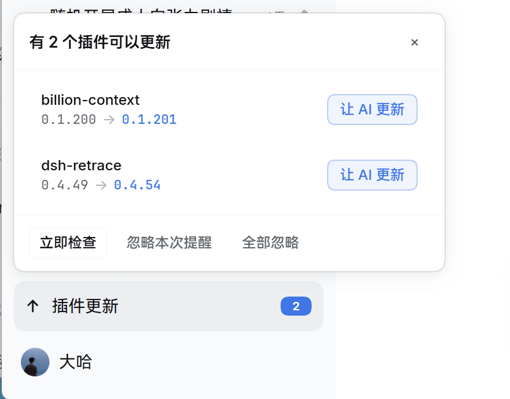
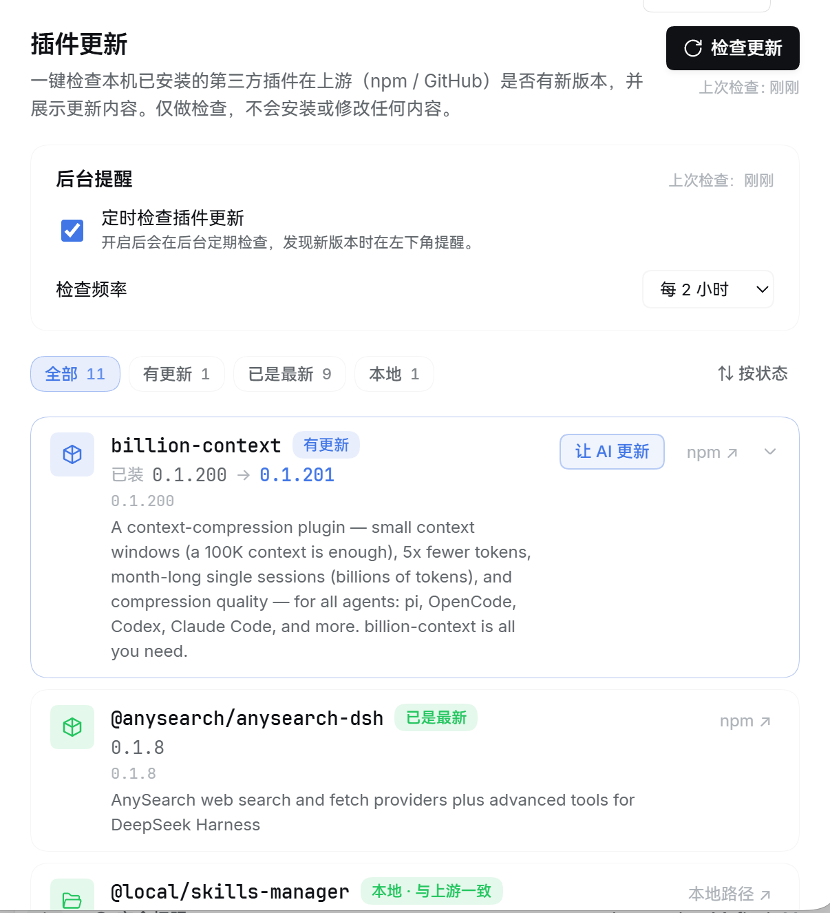

<div align="center">

# 🔔 dsh-update-checker · 插件更新巡检器

**DeepSeek Harness 第三方插件一键与后台智能巡检：上游探测、Release 变更深度解析、侧边栏角标提醒与一键「让 AI 更新」**

[](https://github.com/daha1216/dsh-update-checker/releases)
[](./LICENSE)
[](https://github.com/topics/dsh-plugin)
[](https://github.com/daha1216/dsh-update-checker)
[](https://nodejs.org)

**中文** · [English](./README.en.md)

</div>

---

随着 DeepSeek Harness（DSH）生态的蓬勃发展，上下文压缩、技能管理、会话时光机等各类第三方插件极大地拓展了智能体的能力边界。然而在日常使用中：
- 关键安全漏洞已修复、重要特性已发布，你却对上游新版本浑然不知？
- 每次都要手动在 npm、GitHub Releases 与本地开发目录之间逐个比对版本，繁琐且费时？
- 市面上的更新工具要么容易暗中破坏本地依赖环境，要么动辄消耗大量网络配额？

**dsh-update-checker** 是专为 DeepSeek Harness 打造的**原生级「插件更新巡检器」**。它坚守 **「纯净只读巡检 · 绝不越权修改」** 的安全铁律，不仅提供一键全景扫描与详尽的 Release 变更对比，更支持低开销的**后台定时自动巡检**与**侧边栏轻量角标提醒**。发现新版本时，轻轻一点即可将更新指令交由 AI 智能体在受控环境下安全完成。

---

## 📸 实机体验

<div align="center">

| 侧边栏常驻提醒浮层（后台智能巡检） | 设置中心「插件更新」全景管理面板 |
| :---: | :---: |
|  |  |
| *后台定时巡检静默运行，发现新版本时在侧边栏底部展示数量角标，点击唤起交互气泡，支持一键「让 AI 更新」与版本忽略* | *一键全景扫描，按状态即时筛选（全部/有更新/最新/本地），可视化配置巡检频率，直观浏览 Release 变更日志* |

</div>

---

## ✨ 核心特性

### 1. 🔍 一键全景扫描与多源状态精准识别
- **全依赖自动穿透**：智能解析当前 Profile 的 `package.json`，自动区分第三方扩展，自动跳过官方内置的基础包（`@deepseek-ai/*`）。
- **全源格式兼容**：
  - **npm 版本依赖**（`^1.2.3`、`~0.1.6`、精确版本）：优先查询 npm 官方镜像源，并支持 npmmirror 智能回退。
  - **GitHub 远程引用**（`github:owner/repo#tag`）：精准比对 GitHub Releases 最新稳定版本；分支或 Commit 引用自动判为「跟踪分支」。
  - **本地开发安装**（`file:` / `link:`）：若项目声明了 GitHub 仓库，自动比对本地与上游差异，清晰标明「本地领先」、「本地落后」或「与上游一致」。
- **状态细分与统计筛选**：提供 `全部`、`有更新`、`已是最新`、`本地`、`需关注` 等状态过滤 Chips，并支持一键按状态或名称排序。

### 2. 🔔 智能后台调度巡检与侧边栏实时气泡
- **灵活的后台巡检机制**：支持在设置中心自定义巡检频率（每 30 分钟 / 1 小时 / 2 小时 / 6 小时或自定义分钟数）。
- **非侵入式轻量提醒**：发现新版本后，仅在左下角侧边栏底部显示低调的待更新数量角标（如 `↑ 插件更新 2`），绝不弹窗打扰当前对话与编码心流。
- **丰富的气泡操作**：
  - **版本迁移直观对比**：清晰展示每个待更新插件的 `当前安装版本 → 最新稳定版本`。
  - **忽略本次提醒**：本次暂不提醒，待检测到更高版本或手动点击检查时重新触发。
  - **全部忽略**：将当前所有待更新插件标记为已阅，跳过当前版本的持续提醒。
  - **状态持久化防丢失**：即便重启 DSH 桌面端或重载宿主，忽略列表与待更新状态完整保留。

### 3. 🤖 无缝联动智能体：「让 AI 更新」
- **坚守只读安全底线**：插件自身**绝不静默运行任何安装脚本、绝不修改 `node_modules` 与配置文件**。
- **一键智能委托**：在气泡弹窗或插件列表点击「让 AI 更新」，插件会自动在当前会话输入框填入标准化提示词（例如 `帮我更新 billion-context 插件`）。未聚焦或无会话时自动回退为剪贴板复制，由 DSH 智能体遵循该插件的官方规范完成环境备份、版本更新与重启验证。

### 4. 📖 深度 Release 变更日志解析（Changelog Diff）
- **区间化更新呈现**：自动抓取并聚合「当前安装版本 → 最新版本」之间的所有 Release 发行记录，不漏掉任何中间修复。
- **纯原生 Markdown 渲染**：内置自主实现的高性能轻量 Markdown AST 解析器（涵盖多级标题、列表、代码围栏、引用块、粗体与链接等）。
- **零 XSS 隐患**：纯字符串到 AST 再到安全 React 节点，全程不使用 `innerHTML`。
- **按需惰性渲染**：默认保持折叠，展开单行时才解析渲染正文，即便长达数万字的更新日志也能瞬间展开，丝滑流畅。

### 5. ⚡ 工业级统一出站网络层与零配额浪费
- **单飞并发合并（Single-Flight Coalescing）**：同一时刻对相同 URL 的并发探测合并为单一网络请求（如多个插件引用同一上游仓库时共享一次请求）。
- **TTL 内存缓存 + ETag 条件请求（304 Not Modified）**：
  - 响应结果在 5 分钟内直接由内存返回；
  - 缓存过期后自动附带 `If-None-Match` 发起条件验证，**GitHub 304 响应完全不消耗匿名 API 配额**（60次/小时/IP）！
- **支持高额 API Token**：在宿主环境配置 `GITHUB_TOKEN` 或 `GH_TOKEN`，自动以 Bearer 头鉴权，配额提升至 5,000 次/小时。
- **全局并发限流与熔断保护**：出站并发上限严格控制为 6；若遭遇上游 403/429 限流，自动按 `x-ratelimit-reset` 进入静默冷却，并平滑降级至 jsDelivr CDN 保证可用性。
- **npm dist-tags 极速路径**：优先请求仅 ~200B 的轻量级 `dist-tags`，绝大多数已是最新版的插件一击即中，省去下载 MB 级完整 packument 的巨额带宽与时间。

### 6. 🛡️ 架构稳定性与原生设计融合
- **严格遵循 Cordis 4 生命周期**：清理逻辑全部通过 `ctx.effect` 挂载；调度器状态使用闭包隔离，杜绝向 `ctx` 挂载私有属性导致宿主崩溃的风险。
- **原子化落盘与 Profile 隔离**：状态写入采用临时文件（tmp）+ 重命名（rename）的原子操作；缓存按 Profile 严格分离存储，多 Profile 环境下绝不串台。
- **进程内串行写锁（withStateLock）**：彻底解决后台巡检落盘与用户前端操作（如点击忽略）之间的并发竞态问题。
- **深度融合 DSH Design Tokens**：经历 v0.3.2 配色全量重构，深色模式下按钮文字、高亮链接、卡片阴影与边框完全对齐官方无障碍标准。

---

## 🧭 状态含义一览

| 状态标识 | 界面展示 | 详细含义 |
|---|---|---|
| `update` | **有更新** | 上游存在比当前安装版本更新的正式稳定版，可展开查看多版本 Release 日志。 |
| `local-behind` | **本地 · 上游有新版** | 本地开发安装（`file:` / `link:`）声明的版本低于上游最新版。 |
| `local-ahead` | **本地 · 领先上游** | 本地安装版本高于上游最新正式版（处于前沿开发中或上游发生版本回滚）。 |
| `local-latest` | **本地 · 与上游一致** | 本地安装版本与上游最新正式版完全吻合。 |
| `latest` | **已是最新** | npm 安装版本与上游最新稳定版一致。 |
| `branch` | **跟踪分支** | 安装来源为分支或特定 Commit（如 `#main`、commit sha），不适用 SemVer 比较。 |
| `unknown` | **无法比较** | 引用形式无法识别出标准版本号（如非标准 tag）。 |
| `local` | **本地安装** | 本地安装且未声明上游 GitHub 仓库，无参考基准。 |
| `error` | **检查失败** | 查询上游失败（网络超时、域名无法解析或触发限流等），卡片内展示具体原因。 |

---

## 📦 安装与配置

> **前置要求**：已安装 DeepSeek Harness 且 Node.js 版本 ≥ 22。

### 方式一：推荐通过 Profile 安装（GitHub 远程源）

在终端中执行以下命令（以桌面版 Profile 为例）：

```bash
# 桌面版安装
dsh plugin --profile desktop add github:daha1216/dsh-update-checker

# Web 独立服务部署安装
dsh plugin --profile web add github:daha1216/dsh-update-checker
```

> 💡 **重要说明**：
> 1. 安装完成后，**请完全退出并重新启动 DSH 桌面端**（使宿主模块加载生效），然后**刷新一次 GUI 页面**（加载设置页脚本）。
> 2. 后续若要更新巡检器自身，重新运行上述相同的 `add` 命令即可。

### 方式二：本地开发安装（Checkout 模式）

如果你希望在本地克隆并进行调试修改：

```bash
git clone https://github.com/daha1216/dsh-update-checker.git "D:/dsh work/dsh-update-checker"
dsh plugin --profile desktop add "file:D:/dsh work/dsh-update-checker"
```

---

## 🔑 环境变量与限额优化

| 环境变量 | 作用说明 |
|---|---|
| `GITHUB_TOKEN` / `GH_TOKEN` | 用于以 Bearer 格式鉴权 GitHub API。未设置时保持匿名模式（60 次/小时/IP）；设置后配额提升至 **5,000 次/小时**。 |

---

## 🏗️ 项目架构与技术细节

```
dsh-update-checker/
├── index.js          # Cordis 宿主插件核心：路由注册、RPC 通信、后台定时巡检调度器、生命周期管理
├── lib/
│   ├── http.js       # 统一出站网络层：单飞并发合并、TTL 缓存、ETag 304 条件复用、主机熔断与降级
│   ├── checker.js    # 纯函数检查逻辑：package.json 解析、多源版本探查、Release 聚合对比
│   ├── reminder.js   # 提醒状态管理：指纹计算、忽略策略、多 Profile 原子化落盘与并发串行写锁
│   └── md.js         # 零依赖轻量 Markdown 解析器：安全 AST 构建与 React 元素映射
├── client/
│   └── client.js     # 客户端设置中心与侧边栏渲染面板：双语国际化、UI 状态机、交互反馈
├── locale/           # 插件元信息多语言配置（zh.json / en.json）
├── assets/           # 实机界面展示资源
└── test/             # 详尽的自动化测试套件
```

### 1. 通信机制与安全栅栏
- 客户端设置页与侧边栏浮层通过 Connection RPC 通道（`/dsh-update-checker`）与宿主端通信。
- 宿主端将通道以 `kind: 'prefix'` 路由挂载至受信任的 `webServer` 上，逐分支遵循官方 `/api` 传输规范，并使用严格的同源与 Loopback 校验作为请求安全防护栏。

### 2. 调度器容错与并发保证
- 调度器完全闭包化，杜绝属性逃逸污染。定时器在纤维失效前即被 `ctx.effect` 严格清理。
- 运行中修改检查频率支持即时重排，任意时刻保证全局仅有一个活跃的巡检定时器。
- 扫描结果落盘与用户前台点击「忽略」通过 `withStateLock` 排队处理，杜绝数据覆写。

---

## 🧪 自动化测试

项目遵循严格的测试驱动开发规范，内置 8 个独立测试套件、覆盖 **190+ 项断言**，涵盖纯函数、出站层、端到端集成与宿主生命周期验证：

```bash
# 运行离线全量单元测试
npm test

# 运行真实环境端到端测试（临时隔离环境）
npm run test:e2e
```

测试矩阵包含：
- `test/checker.test.mjs`：38 项断言，覆盖版本提取、来源判定与状态流转；
- `test/http.test.mjs`：19 项测试，覆盖 TTL 缓存、单飞合并、ETag 304 条件复用与熔断降级；
- `test/integration.test.mjs`：21 项测试，脚本化网络模拟下的复杂检查流；
- `test/md.test.mjs`：23 项测试，深度校验 Markdown 语法解析保真度；
- `test/render-harness.mjs`：客户端设置页与浮层气泡离线渲染冒烟测试；
- `test/lifecycle.test.mjs`：真实 Cordis 4 环境下插件加载、卸载与资源释放测试；
- `test/reminder.test.mjs`：56 项断言，后台提醒状态机、忽略语义与原子读写校验；
- `test/reminder-scheduler.test.mjs`：33 项断言，调度器防重排竞态与 RPC 降级回归测试。

---

## 📝 更新日志

### v0.3.5（2026-10-19）
- **修复巡检重排竞态**：解决在扫描执行期间修改间隔可能遗留两个定时器的问题。重排请求统一由收尾时处理，保证任意时刻仅有一个定时器，新间隔即刻生效。
- **引入状态写串行锁（withStateLock）**：将后台扫描结果记录与用户前台「忽略」操作纳入队列，彻底避免状态并发覆盖。
- **RPC 回退路径增强**：`connection.rpc.handle` 回退路径在无 webServer 环境下优雅降级，防止激活失败。
- **自定义间隔智能适配**：手动写入非预设检查间隔时，设置面板自动动态添加对应项并正确选中。
- **测试矩阵增补**：增补调度器重排与容错回归断言，总断言数增至 33 项。

### v0.3.4（2026-10-19）
- **修复待更新状态持久化读回丢失**：重构状态反序列化校验逻辑，解决从 `reminder-<profile>.json` 读回时待更新列表被清空的偶发问题。
- **一键「让 AI 更新」体验落地**：卡片与浮窗按钮升级为「让 AI 更新」，点击后自动向会话输入框填入标准化提示词。
- **UI 布局优化**：将「后台提醒」卡片提升至设置页顶部，配置更直观。

### v0.3.3（2026-10-18）
- **Cordis 4 架构深度重构**：修复 DSH 0.2.1-rc.2 宿主上的崩溃问题；调度器状态收敛为闭包私有；清理函数移至定时器启动前注册。
- **正式引入侧边栏浮层提醒**：实现设置中心定时轮询配置、侧边栏底部待更新角标与交互气泡浮窗。

### v0.3.2（2026-10-18）
- **深色模式全量重构**：全面对齐 DSH 官方 Design Tokens（`--dsw-alias-button-primary-fill`、`--dsw-alias-link`、`--ds-font-family-code`），彻底解决深色模式下白底白字与按钮糊团问题。

### v0.3.1（2026-10-18）
- **Profile 隔离与状态增强**：缓存文件按 Profile 隔离；新增 `local-ahead`（本地领先上游）状态；修复 Release 过滤区间；支持 `GITHUB_TOKEN` 高额鉴权。

### v0.3.0（2026-10-17）
- **统一出站网络层重构**：引入限流、单飞合并、TTL + ETag 缓存、主机熔断与 npm dist-tags 极速路径。

---

## 📄 开源协议

本项目基于 [MIT License](./LICENSE) 协议开源。

## 🔗 相关项目

- 收录于 [dsh-plugin-collection](https://github.com/daha1216/dsh-plugin-collection)（DSH 精选第三方插件索引）。
- 欢迎探索同作者的其他 DSH 实用工具：
  - [dsh-retrace](https://github.com/daha1216/dsh-retrace) — 会话时光机：消息撤回、原地编辑重发与产物版本化回退。
  - [dsh-skills-manager](https://github.com/daha1216/dsh-skills-manager) — 本地技能可视化管理面板：一站式配置模型与用户调用策略。
  - [dsh-watcher](https://github.com/daha1216/dsh-watcher) — 跨会话环境变更监控器。
